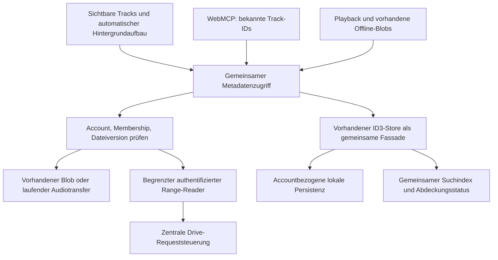

> Implementation amendment, 22 October 2026: the user authorized implementation and explicitly approved a bounded same-origin Range endpoint after authenticated Google responses hid Content-Range in browser CORS. This supersedes the no-automatic-proxy restriction below for this approved endpoint only. See [endpoint contract](../metadata-range-endpoint.md) and [implementation evidence](../metadata-implementation-verification.md). No deployment or destructive migration execution is authorized.

# ID3-Metadaten: Recherche und Arbeitspaket

Stand: 22.10.2026. **Plan, keine Produktimplementierung.** Die Recherche vom 15.10. nutzte drei unabhängige Subagents für Cache/WebMCP, Drive/Playback/Requeststeuerung und Primärquellen. Am 22.10. wurden die Produktvorgaben zu automatischem Hintergrundaufbau und minimaler UI übernommen sowie die Folgen eines rein lokalen Tag-Caches im aktuellen Code geprüft.

Aktuelle Produktvorgabe: Der Nutzer muss keinen Index starten oder verwalten. Sichtbare Tracks haben Vorrang, die übrige Library wird automatisch und gedrosselt im Browser untersucht. Optional ein kleiner Aktivitätsindikator mit Details auf Klick; keine technische Einrichtung oder Aufforderung zur Indizierung. Architekturvorschlag zur Bestätigung vor Umsetzung: ausgelesene Tags ausschließlich lokal halten und den bisherigen Cloud-Tag-Sync samt `track_metadata` in einem getrennten, kontrollierten Schritt entfernen. Die Frage nach einer Tabellenlöschung ist keine Freigabe für eine tatsächliche Datenlöschung.

## Empfehlung

Einen gemeinsamen Metadatenzugriff hinter dem vorhandenen ID3-Store aufbauen. Bereits vorhandene Tags in allen bestehenden WebMCP-Trackausgaben zurückgeben; fehlende Tags durch ein zusätzliches begrenztes WebMCP-Tool laden. Vorhandene Audio-Blobs zuerst verwenden, ansonsten authentifizierte, strikt begrenzte Range-Reads mit dem installierten Parser. Alle Drive-Reads zentral priorisieren; zunächst ein aktiver Drive-Transfer pro Website-Sitzung.

Beim Öffnen zuerst tatsächlich sichtbare Zeilen laden, danach den Current Folder und die übrige nachgewiesene Library automatisch in begrenzten Hintergrundabschnitten bearbeiten. Die Arbeit gehört zum gemeinsamen Metadatenmodul und läuft auch ohne WebMCP-Aufruf. Ein persistierter Arbeitsstand ermöglicht Fortsetzung nach erneutem Öffnen; neue/aktualisierte Librarygenerationen ergänzen oder verwerfen Jobs. Keine zusätzlichen rekursiven Drive-Listings pro Track: vollständigen vorhandenen Librarykatalog verwenden, dessen Aufbau ebenfalls zentral steuern. Gewöhnliche Nutzer sehen keine Indexverwaltung. WebMCP bekommt präzise Abdeckung und Wartegründe aus demselben Zustand.

### Automatischer Katalogstart und Wiederaufnahme

Der Indexkoordinator startet nach authentifizierter Accounthydrierung, verfügbaren Imports und sichtbarem/online Dokument selbstständig `ensureReady` für den Librarykatalog; Suchtexteingabe oder Agentenaufruf sind kein Startkriterium. Vorhandene passende persistierte Generation sofort übernehmen. Ohne Katalog oder nach geändertem Importscope einen gemeinsamen vollständigen Build einreihen. Stale Kataloge im Hintergrund frühestens nach der bestehenden 24-Stunden-Kadenz neu erfassen; Remount, Resume, neue Suche und neu geöffnetes Tab umgehen weder Kadenz noch vorhandenen Single-Flight. Änderungen an Imports invalidieren den Membershipnachweis sofort. Sichtbare nachgewiesene Ordner und gespeicherte Collections dürfen während des Builds schon Metadaten laden; Librarytotal bleibt bis zum vollständigen Build null.

Der aktuelle Build listet unterstützte Audiodateien und Ordner im gesamten für die Autorisierung erreichbaren Drive, bevor er die importierte Library lokal abgrenzt (`lib/library-search-drive.ts`). Das wird durch den automatischen Start nun bewusst auch ohne Suche ausgelöst. Alle Seitenrequests zählen zum gemeinsamen Hintergrundbudget, Metadaten-/Queueausgaben enthalten weiterhin nur nachgewiesene Librarytracks. Kein Auslesen von Audiodaten außerhalb dieses Scopes; keine unvollständige Kataloggeneration publizieren.

Fordert ein Nutzer oder Agent währenddessen Library Search an, wird **derselbe** Build für die Dauer dieses Verbrauchers zu Foregroundarbeit befördert: keine Abschnittspause/1-GET-pro-Sekunde-Bremse des opportunistischen Hintergrunds, aber weiterhin gemeinsamer Transport, Providercooldown und begrenztes Foregroundbudget. Für kalte agentenseitige Suche zunächst maximal 15 Sekunden einschließlich Queuezeit und höchstens 20 zusätzliche Listingversuche pro Aufruf; danach Verbraucher lösen, wieder Hintergrundpriorität und `library_indexing` mit Fortschritt/gegebenenfalls `retryAfterMs` liefern. Keine unvollständige Liste als vollständiges Suchergebnis zurückgeben. UI bleibt mit Current-Folder-/Cacheanzeige bedienbar und kann auf Katalogfertigstellung reagieren. Toolbeschreibung „cold refresh several seconds“ entsprechend um noch laufenden Aufbau/gezieltes späteres Wiederholen ergänzen. Eine Promotierung umgeht keine Providerfrist. Abnahme: Suche während verbrauchtem Hintergrundbudget läuft begrenzt weiter oder gibt innerhalb ihrer Deadline ehrlichen Indexstatus; kein zweiter Build und kein minutenlang hängendes Tool.

Die bestehende 16-MiB-Persistenzgrenze bleibt zunächst erhalten. Überschreitet der Katalog sie oder ist IndexedDB nicht verfügbar, bleibt er session-only: nach erneutem Öffnen muss ein neuer vollständiger Build stattfinden. Den accountbezogenen Scan-/Cooldownzustand trotzdem soweit verfügbar persistieren; gespeicherte Tagresultate nach neuem Scope-/Versionsnachweis wiederverwenden. Session-only-Persistenzprobleme dem Agenten/Detailpanel ehrlich melden, keine dauerhafte Fortsetzbarkeit versprechen. Bei nicht verfügbarer dauerhafter Koordination pausiert automatische Libraryarbeit, siehe tabübergreifende Steuerung; direkte Reads bleiben begrenzt möglich. Abnahme: Start ohne Suche/Agent, exakt ein gleichzeitiger Build pro Account, kein erneuter Build vor Ablauf der Kadenz ohne Scopeänderung, sowie kontrollierter Neuaufbau des session-only Falls nach Reload.

## Nachgewiesener Stand

Die folgende Bestandsanalyse und ihre Zeilennummern stammen vom 15.10.: `main` bei `f78a4da70a1e7f2cbf5af15740492039135b6ee0`. Am 22.10. erneut geprüft: `main` bei `df1b47a39bb9b839cc9e641928b3a227b02fde5a`; die Tabelle `track_metadata` und ihre Sync-/Uploadpfade existieren weiterhin. `favorite_tracks` und `playlist_tracks` speichern unabhängig davon Dateinamen, IDs und weitere Dateideskriptoren. Keine erneute vollständige Codeanalyse oder Live-Datenbankprüfung am 22.10. Bereits vorhandene Änderungen an `GLOSSARY.md` und `docs/research/native-wrapper-platforms.md` bleiben unberührt. Pfade unten relativ zum Repository.

| Codefakt | Beleg | Auswirkung |
| --- | --- | --- |
| Playback lädt die vollständige Datei vor ID3-Extraktion; Offline-Blob wird vorher geprüft. | `apps/drivebeats-web/src/stores/player-store.ts:790–870` | Vollabruf für reine Metadaten vermeiden; vorhandenes Audio wiederverwenden. |
| Next-Track-Prefetch lädt ebenfalls den vollständigen Blob und extrahiert danach. | `apps/drivebeats-web/src/stores/player-store.ts:1570–1644` | Metadaten dürfen keinen zweiten Transfer derselben Version auslösen. |
| Parser gibt nur title/artist/album zurück; fehlende Zielwerte und Parserfehler werden beide `null`. | `apps/drivebeats-web/src/lib/id3-metadata.ts:14–36` | Negative Ergebnisse und Fehler sind bisher ununterscheidbar. |
| Store persistiert positive Tags unter fileId; Dedup nur Set von fileIds; fehlender modifiedTime auf einer Seite zählt als Cachehit. | `apps/drivebeats-web/src/stores/id3-metadata-store.ts:5–24,98–144,151–154` | Kein awaitbares gemeinsames Ergebnis; keine zuverlässige Versions-/Accounttrennung. |
| clearAll leert den Cache, aber laufende Extraktion und Uploadtimer bleiben bestehen. | `apps/drivebeats-web/src/stores/id3-metadata-store.ts:26–64,116–149` | Statisch mögliche späte Writes nach Logout; hier nicht reproduziert. |
| Logout leert lokale Metadaten absichtlich. | `apps/drivebeats-web/src/lib/clear-local-data.ts:63–64` | Wachstum über Reloads/gewöhnliche Sessions; expliziter Logout bleibt Löschgrenze. |
| Mobile Zeilen nutzen Tags; Desktop zeigt weiterhin file.name. Artist-only wird im Displayresolver ignoriert. | `apps/drivebeats-web/src/components/file-list.tsx:119–160,260–268`; `apps/drivebeats-web/src/lib/track-metadata.ts:14–26` | Vorladen allein korrigiert die Desktop-Tabelle nicht. |
| visibleFiles sind zunächst bis zu 200 gerenderte Zeilen, kein Viewport-Nachweis. | `apps/drivebeats-web/src/components/file-list.tsx:48–49,375–377` | Sichtbares Vorladen braucht IntersectionObserver oder gleichwertige Sichtbarkeitsprüfung. |
| publicTrack liefert nur id/fileName; Status, Search, Collections und Queue nutzen ihn. | `apps/drivebeats-web/src/lib/webmcp-tools.ts:59–61,148–153,550–564,595–597,680–683` | Gemeinsamen Serializer erweitern, keine isolierte Agentenlösung. |
| Suche ist ausschließlich Dateiname; Katalog grenzt über importierte Abstammung/Standalone Tracks ein. | `apps/drivebeats-web/src/lib/file-search.ts:21–28`; `apps/drivebeats-web/src/lib/library-search-catalog.ts:34–154` | Tags lokal ergänzen, Scope und vollständige Kataloggeneration erhalten. |
| Google-Fetch startet direkt, ohne Range und ohne globale Queue; bis zu drei Versuche bei ausgewählten Netzwerk-/HTTP-Fehlern. | `apps/drivebeats-web/src/lib/google-api.ts:81–120,175–215` | Separate Loader könnten trotz eigener Serialisierung konkurrieren. |
| Offline-Manager arbeitet mit zwei Workern; Import nutzt Promise.all; Folder/Catalog haben eigene Dedup-Mechanismen. | `apps/drivebeats-web/src/lib/offline-download-manager.ts:29,1000–1025`; `apps/drivebeats-web/src/hooks/use-drive-import.ts:36–59` | Playback, Import, Listing, Offline und Metadaten gemeinsam steuern. |
| Folderlistings werden nach 5 Minuten stale, Librarykatalog nach 24 Stunden. | `apps/drivebeats-web/src/stores/folder-cache-store.ts:13`; `apps/drivebeats-web/src/stores/library-search-store.ts:52` | „Aktuell“ bedeutet gleiche zuletzt verifizierte Version, keine sofortige Kenntnis jeder Driveänderung. |

### Vorschlag: ausgelesene Tags nur lokal, Cloud-Tag-Sync entfernen

`db/migrations/0006_track_metadata.sql` legt eine gemeinsame Tabelle für ausgelesene title/artist/album-Werte an. Sie ist keine separate Favoriten-Tabelle: `lib/cloud-library-service.ts` liest daraus für Playlists und Favorites. Der Vorteil des bisherigen Syncs ist sofortige Taganzeige nach Anmeldung auf einem anderen Gerät. Ein lokaler Cache macht diesen Vorteil nicht technisch identisch verfügbar, erlaubt aber bewusst darauf zu verzichten.

Empfehlung: Tags geräte-/browserbezogen halten. Auf einem neuen Browser oder nach Logout/Storage-Eviction baut sich der Cache erneut auf; bis dahin Dateinamenfallback. Offline sind nur bereits lokal vorhandene Tags/Audio verfügbar. Favoriten und Playlists synchronisieren weiterhin als Collections, einschließlich der für die bisherige Funktion nötigen Dateireferenzen. Aktuell enthalten `db/favorite-tracks.ts` und `db/playlist-tracks.ts` auch Dateiname, MIME, Größe, modifiedTime, parents und parentFolderName. Ob diese Deskriptoren weiter minimiert werden sollen, ist separat zu prüfen; das Entfernen von `track_metadata` allein bedeutet ausdrücklich nicht „keine Liedinformationen auf dem Server“.

Vorgeschlagener Umstieg ohne unnötige Reparatur eines auslaufenden Tag-Syncs:

1. Lokalen Loader/Cache für gespeicherte Collections ohne Cloud-Tags funktionsfähig machen und auf einem frischen Browser prüfen. Tags nicht ersatzweise in Collectionfelder oder andere Cloudtabellen verschieben.
2. Uploadqueue und `isSynced`-Taguploadzweige im ID3-Store/Player entfernen. `saveCloudTrackMetadata`, Tag-Bootstrap, Sync-Payload/Hydrierung, Validation, DB-Lese-/Upsert-/Pruneaufrufe und zugehörige Tests/Dokumentation anpassen. Collection-Mitgliedschaft bleibt für zulässige Drive-Reads erforderlich.
3. Backend nimmt keine neuen Tags mehr an und ignoriert Taganteile alter Bootstrap-Clients, ohne sie zu speichern. Einen sicheren auslaufenden Uploadendpunkt vorsehen, der alten Tabs das Ende des Tag-Syncs signalisiert. Collection-Sync ohne `trackMetadata` muss für alte und neue Clients funktionieren. Keine abhängige Query darf vor der Tabellenentfernung übrig bleiben.
4. Erst nach kompatiblem Rollout und Prüfung aller Verbraucher eine **neue vorwärtsgerichtete Migration** zur Entfernung von `track_metadata` vorbereiten. `0006` nicht umschreiben. Keine tatsächliche Tabellen-/Datenlöschung während dieser Planung; vor Ausführung konkreten Löschumfang bestätigen lassen. Retention in vorhandenen Datenbankbackups separat prüfen, statt sofortige Entfernung aller Kopien zu versprechen.
5. Repositoryguide `AGENTS.md` und sonstige Aussagen zum bisherigen Tag-Sync erst bei der später autorisierten Produktumsetzung auf das neue Modell bringen.

Historische Befunde vom 15.10., relevant für Übergang/Entfernung: POST reicht `modifiedTime` an einen DB-Upsert mit erwartetem `fileModifiedTime`; POST kontrolliert Collection-Mitgliedschaft nicht; damaliger Bootstrap konnte den gesamten lokalen Cache übermitteln. Kein Grund, diese Pfade für einen breiteren Librarycache auszubauen. Uploads bis zum Abschalten nicht erweitern. Keine privaten Datenbankinhalte oder Uploads geprüft.

## Dokumentierte Möglichkeiten und Grenzen

Die unabhängige [Primärquellenrecherche](id3-metadata-primary-sources.md) enthält Quellen und Parserdetails. Google dokumentiert Range-Downloads für Blobdateien; das files-Objekt stellt keine MP3-Artist-/Album-/Titel-Tags bereit. Ein eigener authentifizierter Reader kann den vorhandenen `jsmediatags`-Parser weiterverwenden. Das ist eine Architekturfolgerung, noch kein live validierter Drive-Adapter. [Google Downloadguide](https://developers.google.com/workspace/drive/api/guides/manage-downloads#partial_download), [Files-Ressource](https://developers.google.com/workspace/drive/api/reference/rest/v3/files)

ID3v2 hat einen Header mit Taggröße, ID3v1 sitzt am Dateiende. Ein fixer kleiner Prefix reicht bei großen Tags/Covern nicht sicher. `setTagsToRead` verhindert im installierten Parser nicht den Transfer des gesamten ID3v2-Tags. Deshalb zuerst begrenzte vollständige Tagbereiche lesen; selektives Überspringen von Artwork erst nach Messdaten erwägen. Dauer, BPM und Stimmung sind kein zugesicherter Teil dieses Pakets. [ID3v2.3](https://id3.org/id3v2.3.0), [ID3v1](https://id3.org/ID3v1), [Parserquelle als Navigation; installierte 3.9.7 separat geprüft](https://github.com/aadsm/jsmediatags/blob/master/src/ID3v2TagReader.js)

Der MP3-Rangepfad gilt nicht automatisch für FLAC, M4A, Ogg oder WAV. Version 1 dieses Pakets: MP3-Rangeadapter; andere Formate aus bereits vorhandenen Blobs auslesen, für entfernte Metadaten `unsupported_format` melden. MP3 aus ursprünglichem Drive-MIME `audio/mpeg`/`audio/mp3` oder einer eindeutigen `.mp3`-Endung erkennen, nicht aus dem synthetischen `audio/mpeg`-Fallback in `playlistTrackToDriveFile`. Bei widersprüchlichen Originalangaben gezielt Descriptor verifizieren oder unresolved melden; Byteheader vor erfolgreichem Parsen prüfen. Später formatspezifische begrenzte Reader ergänzen. Das UI darf „nicht untersucht“ nicht mit „keine Tags“ verwechseln.

## Gemeinsamer Zugriff und Cache



Vorgeschlagene kleine Interface: `ensureTrackMetadata(knownTrack, {signal, priority, deadline})` und zentraler cache-only Selektor. Scopeauflösung vor dieser Interface; alle Aufrufer verwenden dieselbe Validierung und denselben Store. Interne Reader-/Schedulerdetails nicht an UI und WebMCP verteilen.

- Persistierter Schlüssel: Account + fileId + Fingerprint. Zunächst `modifiedTime + size`; Drive `version`/`md5Checksum` nur übernehmen, wenn verfügbar und einheitlich durch alle Descriptor-/Collectionpfade geführt. Parser-/Schemasversion speichern. Ohne verlässlichen Fingerprint `freshness: unknown`, gezielt Dateimetadaten revalidieren; nie fehlende Version als dauerhaften Treffer interpretieren.
- Persistierte Ergebnisse: `ready`, `no_target_tags` oder `unresolved`, geprüfte Felder, Format/Prüfumfang, Fingerprint, Parser-/Policyversion, checkedAt, Herkunft. `no_target_tags` bedeutet: unterstützte Tagbereiche erfolgreich auf title/artist/album geprüft; kein Urteil, ob überhaupt irgendein Tag existiert. `unresolved` hält terminale automatische Outcomes mit Grund `unsupported_format|budget_exceeded|range_unsupported|parse_error` fest. Keine neue automatische Probe derselben Datei-/Parser-/Policyversion nach Reload. Für hostabhängige Range-/CORSfähigkeiten den Umgebungsschlüssel berücksichtigen; erst nach verändertem Fähigkeitsnachweis oder expliziter Diagnose wieder freigeben. Kein Fehler darf als negative Tagfeststellung zählen.
- Flüchtige Jobs: `queued`, `loading`, `error`, `deferred`; transiente Fehler mit Retryzeit und Kategorie. Accountweiter Cooldown und Budget bleiben unabhängig davon persistent. Neue Datei-/Parserversion oder später ohnehin verfügbares vollständiges Audio darf einen ungelösten Track neu prüfen; Netzwerkfehler nur mit Backoff, nicht als dauerhafte Taglosigkeit speichern.
- Ein geteiltes Promise pro Account/fileId/Fingerprint. Ein Verbraucherabbruch entfernt dessen Interesse; laufenden Read erst ohne weitere Verbraucher abbrechen. Priorität eines bestehenden Jobs erhöhen, statt Doppeljob anzulegen. Auch Blob-Extraktion und Rangejob deduplizieren; laufenden Audiotransfer möglichst wiederverwenden.
- Vor Fetch und vor Veröffentlichung Account, Import-/Collectiongeneration und Fingerprint erneut prüfen. Neue Version ersetzt alten Eintrag atomar. Ergebnis einer älteren Version darf nach späterer Antwort nicht gewinnen.
- Aktuelle positive und negative Ergebnisse ohne Mediareads wiederverwenden. Bei Folder-/Catalogrefresh Descriptoränderungen invalidieren. Für nur gespeicherte Collections mit alten Deskriptoren gezielt Metadaten revalidieren; keine Libraryneuerfassung dafür. Änderungen außerhalb der Refreshkadenz bleiben zunächst unbekannt; `checkedAt`/`versionObservedAt` offenlegen.
- Storefassade behalten, wachsende Persistenz in accountbezogene IndexedDB-Einträge verschieben; begrenzten Memorycache und Quota-/Write-Fehler behandeln. Keine unbeschränkten synchronen localStorage-Gesamtschreibungen. Legacycache nur nach Account-/Membership-/Versionsnachweis übernehmen, sonst nicht als aktuelle Quelle verwenden. Im vorgeschlagenen Zielmodell keine Tag-Uploads oder Tag-Hydrierung aus Neon; dieselbe lokale Quelle gilt auch für Favoriten/Playlists.
- Logout versiegelt die Generation und leert lokale Daten sowie Jobs/Timer. Gewöhnliches Schließen/Reload behält Ergebnisse. Speicherbereinigung und Browser-Eviction können Vollständigkeit reduzieren; keine dauerhaft garantierte Abdeckung versprechen.

### Range-Reader

Bekannte Dateigröße nutzen; Kopf/Endsignaturen und angeforderte Spannen puffern/zusammenführen. Headergröße vor Reservierung/Download prüfen. Custom `MediaFileReader` implementiert Parserzugriff, Auth, Abbruch und Budgets; Typdeklaration `src/types/jsmediatags.d.ts` entsprechend erweitern. Der Standard-HTTP-Reader und seine Vollabruf-Fallbacks sind für diesen Pfad ungeeignet.

Nur plausibles `206` und passendes `Content-Range` akzeptieren, tatsächliche Bodybytes mitzählen. Bei `200`, ungültiger Spanne, fehlend prüfbaren Headern oder Überbudget Body sofort abbrechen, kein `blob()` auf unbekannt großer Antwort. Ein Clientabbruch garantiert keine null bereits übertragenen Netzwerkbytes. `416` einmal mit frischer Dateigröße/Version behandeln; wiederholter Fehler bleibt sichtbar. CORS/Authorization, sichtbare Antwortheader und Versionskonsistenz zwischen Teilabrufen müssen im Zielbrowser bewiesen werden. Falls der Provider einen nutzbaren Validator anbietet, nutzen; sonst Vor-/Nachprüfung der Metadaten für mehrteilige Reads, bei Versionswechsel Ergebnis verwerfen. Eine solche Prüfung beweist keine atomare Momentaufnahme während des Transfers. Kein automatischer Serverproxy oder Vollabruf als Fallback.

## Zentrale Drive-Requeststeuerung

**Startdefault, noch zu messen:** höchstens ein aktiver Drive-Transfer pro Account im koordinierten Browserprofil; nicht je Loader oder Tab. Alle aktuellen Drive-Einstiege über dieselbe Steuerung führen: Listing, Picker-Metadaten, Librarykatalog, Playback, Next-Track-Prefetch, Offlinedownload und neue Range-Reads. Authrefresh bleibt dedupliziert; reine Cloud-Requests sind ein eigener Dienst und nicht als Drive-Quota zählen. Andere Browserprofile/Geräte sind hiervon unabhängig; Providerlimits können trotzdem account-/projektweit gelten.

Priorität: aktueller Play-/Trackwechsel → direkte Navigation/kleine explizite Reads → unmittelbar benötigter Next-Track-Prefetch → sichtbare Metadaten/angeforderter Katalogrefresh → übriger Ordner-/Libraryaufbau und Offlinedownload. Gleichrangige Arbeit fair bedienen. Prefetch nur für tatsächlich nächsten Track, nicht beliebig viele Dateien. Eine direkte uncached Navigation verdrängt laufenden verzichtbaren Voll-Prefetch oder Offlinedownload; dessen fortsetzbarer Job wird ohne endlose automatische Wiederholung zurückgestellt. Dadurch wartet die Ordnerlist nicht auf einen ganzen großen Audiobody. Aktiven aktuellen Playbackdownload für Navigation nicht abbrechen; dieser seltene Vorrang bleibt begrenzt auf den tatsächlich benötigten Track. Offlineworker können weiterhin zwei Jobs verwalten, die Transportparallelität sinkt bewusst von zwei auf einen; geringerer Offline-Durchsatz ist der Starttradeoff.

- Slot **bis Body vollständig konsumiert oder abgebrochen**, nicht nur bis `fetch()` eine Response liefert. Callback/Lease-Schnittstelle verhindert versteckte Parallelität während `blob()`/`json()`/Streamlesen. Parser lädt intern eventuell mehrere Bereiche an: auch diese zentral serialisieren.
- Playbackbedarf bricht verzichtbare aktive Metadaten-/Offline-/Listingarbeit ab oder verdrängt sie an einer sicheren Teilrequestgrenze; nie aktiven Audiotransfer für Metadaten abbrechen. Verdrängte Verbraucher erhalten wartenden/deferred Zustand und können neu einreihen. Bereits gehörte Audioquelle nicht verändern. CPU-Parsing großer lokaler Tags ebenfalls begrenzen.
- Offline-Manager an den Schedulervertrag anpassen: bestehende Header-/Bodytimer (30/120 Sekunden) erst nach Zuteilung des Transfers starten, nicht während Queuewartezeit. Eine eigene Preempted-Kategorie stellt einen Job ohne verbrauchten Retry-/Unknown-Attempt und ohne Fehlerbackoff zurück; Nutzerabbruch und echter Netzwerkfehler bleiben unterscheidbar. Wiederholte Navigation und über 30 Sekunden Queuewarten dürfen den Job nicht dauerhaft als failed markieren. Bereits übertragene Nutzbytes zählen trotzdem ins Trafficbudget; Neuanlauf ist kein kostenloser Transfer. Foreground-Tooldeadlines laufen dagegen ausdrücklich einschließlich Queuezeit.
- Queue global zunächst auf 100 ausstehende Track-/Listingjobs begrenzen; großer Libraryaufbau speist sie bedarfsgerecht aus dem persistierten Arbeitsstand. Neue nachrangige Arbeit bei Überlauf als deferred/busy melden. Navigation entfernt nicht mehr benötigte Zeilenpriorität; ein unabhängiger Hintergrundverbraucher darf zulässige Arbeit später fortsetzen. Doppelte UI-/WebMCP-Nachfrage konsumiert einen Transfer. Accountwechsel beendet alles aus der alten Generation.
- Browserprofilweite Koordination pro Account: Transport-/Leaderlease mit Web Locks oder atomaren IndexedDB-Transaktionen, Benachrichtigungen über BroadcastChannel. Hintergrundbudgetfenster einschließlich bereits reservierter/verbrauchter Requests/Bytes, `cooldownUntil` und Leader-Fencingzustand persistent und atomar verwalten. Ein Tab-/Reloadwechsel setzt weder Providerfrist noch Budget zurück. Crashs verbrauchte Reservierung konservativ belassen; veralteter Leader darf keine Ergebnisse schreiben. Alle Drivecaller prüfen den gemeinsam sichtbaren Cooldown. Ist zuverlässige geteilte Koordination nicht verfügbar, automatische Libraryarbeit deaktivieren/pausieren und partielle Coverage melden, statt mehrere unabhängige Hintergrundscanner zu starten. Direkte vom Nutzer benötigte Reads bleiben lokal serialisiert und begrenzt; keine globale Slotgarantie für diesen degradierten Fall behaupten.
- Bei `visibilitychange` zum versteckten Leadertab dessen automatische Arbeit pausieren/abbrechen und Lease freigeben; ein sichtbares geeignetes Tab übernimmt mit neuer Fencinggeneration. Sind alle Tabs versteckt, bleibt Hintergrundarbeit pausiert. Resume wählt genau einen sichtbaren Leader. Eingefrorene Tabs/Leaseablauf müssen sicher abgefangen werden; keine neue Arbeit unter altem Fencingtoken. Abnahme: Wechsel von Leadertab A zu sichtbarem Tab B setzt begrenzte Arbeit ohne Doppelrequests und ohne Reset von Budget/Cooldown fort.
- Rate-Limits accountbezogen zentral behandeln: `429` sowie konkrete Drive-403-Quota-Gründe mit exponentiellem Backoff und Jitter; andere 403 nicht blind wiederholen. `Retry-After` niemals unterschreiten, auch bei langer Wartezeit; lange Sperre als `retryAfterMs` zurückgeben, nicht Tool offenhalten. Slot während Wartezeit freigeben, Accountcooldown tabübergreifend erhalten. Nicht jeden Loader unabhängig retryen lassen: bestehende HTTP- und Offline-Retryschichten dürfen sich nicht multiplizieren; die bisherige Offline-Kappung langer Providerfristen auf fünf Minuten ablösen. Playbackpriorität umgeht kein Providerlimit.
- Netzwerk/offline: keine Retryschleife offline; positive/negative Cachewerte bleiben verfügbar. Neue Jobs begrenzt deferieren. 401 einmal über bestehenden deduplizierten Authrefresh; 404/Permission eindeutig melden. Wiederholte unspezifische Fetchfehler pausieren opportunistisches Laden, statt einen unbekannten Browserfehler hochzuskalieren.

### Vorläufige Budgets

Diese Zahlen sind Vorschläge zum sicheren Start, keine gemessenen Optima oder Google-Garantien:

| Grenze | Vorschlag |
| --- | --- |
| Agentenbatch | 1–10 eindeutige IDs, maximal 512 Zeichen je ID |
| Tooldeadline | Standard/maximal 15 Sekunden, einschließlich Queuezeit |
| Remote-Metadaten je Track | maximal 1 MiB Bodybytes; maximal 4 Rangeversuche, Retries mitgezählt |
| Descriptorprüfung je Track | maximal 2 zusätzliche files.get-Versuche für Vor-/Nachprüfung; sämtliche Requests im Batchbudget mitzählen |
| Batch | maximal 2 MiB und 20 tatsächliche Drive-GET-Versuche, Cachetreffer kosten null |
| Automatischer Hintergrundabschnitt | maximal 5 MiB/50 GET-Versuche; Arbeitsstand persistieren, danach automatische zeitgesteuerte Pause |
| Hintergrundtempo | zusätzlich höchstens ein Hintergrund-GET pro Sekunde; Abschnittbudget frühestens nach zwei Minuten erneuern, bei Providerlimit länger warten |

Diese Hintergrundwerte sind noch zu kalibrieren und keine notwendige Nutzereinstellung. Ein Abschnittbudget wird nicht durch Rendern, Scrollen, Suche oder erneuten Toolaufruf zurückgesetzt. Ein einzelner zu großer/fehlerhafter Track darf die Queue nicht blockieren oder bei jedem Abschnitt wieder starten. Dauerhafte Grenzen als unresolved zählen, übrige Tracks fortsetzen. Große Libraries können mehrere geöffnete Sessions benötigen; keine feste Fertigstellungszeit versprechen.

CORS-Preflights gesondert in Messungen zählen; ihre Zahl und Transportbytes kann der Browserreader nicht zuverlässig selbst begrenzen. Budgets zählen gelesene Nutzbytes/gesendete APIversuche; nicht als harte Obergrenze des gesamten Netzverkehrs ausgeben. Große Cover können selbst 1 MiB überschreiten: dann `budget_exceeded`, nicht `no_target_tags`; bestehendes Playback darf Tags später aus ohnehin geladenem Audio gewinnen.

## WebMCP-Vertrag

Bestehende Ausgaben cache-only erweitern: `publicTrack` für Search, Collection-Tracks, Status/Playback, Queueergebnis. Keine Medienabrufe durch Status, Search oder Listen.

```json
{
  "id": "known-track-id",
  "fileName": "01_artist-title.mp3",
  "metadata": {
    "status": "ready",
    "freshness": "current",
    "tags": { "title": "Actual title", "artist": "Actual artist" },
    "provenance": "audio_tags",
    "loadedVia": "drive_range",
    "checkedAt": 0
  },
  "display": {
    "title": "Actual title",
    "subtitle": "Actual artist",
    "titleSource": "audio_tags",
    "subtitleSource": "audio_tags"
  }
}
```

`current` bedeutet passend zum zuletzt validierten Fingerprint. `stale`/`unknown` explizit melden; veraltete Werte nicht als aktuelle Tags durchsuchen. Herkunft pro Displayfeld unterscheiden: `audio_tags`, `filename`, `folder_context`. Ordnername ist Kontext, kein nachgewiesener Artist/Album. Fehlende Tagfelder weglassen; echte Artist-only-Tags mit Dateinamen-Titelfallback kombinieren.

Neues Tool: `drivebeats_load_track_metadata`.

```text
input:  { trackIds: string[1..10], mode?: cache_only|load_missing,
          timeoutMs?: integer[1000..15000] }
defaults: load_missing, 15000
output: { ok, observedAt, timedOut, remainingTrackIds,
          tracks: [{ id, fileName, metadata, display, loadedNow,
                     error?: { code, retryable, retryAfterMs } }],
          budget: { requestsUsed, bytesRead } }
```

- Runtime validiert zusätzlich zur JSON Schema. Doppelte IDs ablehnen; Reihenfolge erhalten. Kein `force`, keine URL, keine beliebige Drive-ID, keine Tokens/Audio-/Download-URLs im Ergebnis. Schema `additionalProperties:false` für den neuen Eingang.
- Zulässige IDs: nachgewiesene Library des aktuellen Accounts/aktueller Imports oder verifizierte eigene gespeicherte Collections. Gemeinsamen Known-Track-Resolver aus vorhandener WebMCP-Logik entwickeln; keine komplette Libraryrefresh für diese Einzelanfrage. Für UI und Agent darf auch eine accountpassende aktuelle Folderlist mit nachgewiesener Navigationskette zum Imported Folder dienen; nicht irgendeine Cachelist ohne Abstammungsnachweis. So funktioniert Zeilenladen vor dem ersten vollständigen Librarykatalog. Unbekannte IDs ohne Drivefetch als `track_not_found`/`library_unavailable` abweisen. Cachehit allein ist kein Membershipnachweis. Mitgliedschaft vor Ausgabe erneut prüfen.
- `metadata.status`: `missing|queued|loading|ready|no_target_tags|unresolved|deferred|error|unavailable`; `freshness`: `current|stale|unknown`; `loadedVia`: `local_blob|drive_range`, sofern vorhanden. `provenance: audio_tags` unabhängig vom Transport. Terminale unresolved-Gründe mit `retryable:false` für den automatischen Aufbau melden; Datei-/Policywechsel kann das ändern. Noch nicht fertig bearbeitete IDs explizit in remainingTrackIds; unresolved nicht als wiederholt abzuarbeitende Rest-ID ausgeben. Batchteilerfolge sind normal.
- Fehlercodes: `offline`, `rate_limited`, `budget_exceeded`, `timeout`, `range_unsupported`, `unsupported_format`, `parse_error`, `permission_denied`, `not_found`; äußere Auth-/Account-/Scopefehler nutzen die bestehende Recovery. cache_only liest vorhandenen Zustand ohne Drive-/Cloudfetch; fehlt lokaler Membershipnachweis, ehrlich unavailable/library_unavailable liefern. Nur load_missing darf notwendige gezielte Descriptor-/Collectionverifikation auslösen; diese zählt zur Deadline und zum jeweiligen Requestbudget, ohne Libraryrefresh.
- Interne Deadline: Verbraucher lösen, unbenötigte Jobs abbrechen, fertiggestellte Werte zurückgeben, übrige als deferred/timeout. Kein verwaister Hintergrundjob nach Toolreturn, außer ein unabhängiger UI-/Playbackverbraucher benötigt ihn weiter.
- Hostabbruch über `execute(input,{signal})`: Interesse lösen und Reads soweit möglich stoppen; **kein garantiertes partielles JSON** versprechen, da der Host den Aufruf bereits verworfen haben kann. Schon abgeschlossene Cacheeinträge bleiben gültig. Nach Logout keine alten Ergebnisse zurückgeben. [WebMCP-Abbruchmodell](https://webmachinelearning.github.io/webmcp/#pending-tool-executions)
- Read-only-Hinweis und untrusted-content-Hinweis setzen; Beschreibung nennt Netzabruf und lokalen Tag-Cache. Collection-Sync bleibt eine separate Funktion. Tags/Filenames bleiben nicht vertrauenswürdige Nutzdaten.

## Suche und UI

Dateiname bleibt vollständig durchsuchbar. Aktuelle gecachte title/artist/album zusätzlich lokal durchsuchen, über gemeinsame Suchfunktion für UI und WebMCP; kein Metadatenladen durch Suchbegriffe. Bestehende tokenweise AND-Semantik über die verfügbaren Felder erhalten; `matchedFields` melden. Ordnerkontext nicht ohne eigene Produktentscheidung als Tag oder zusätzliches Suchfeld ausgeben.

`catalogComplete` und `metadataCoverage` trennen. Für einen vollständigen aktuellen Librarykatalog sind die Buckets disjunkt: `ready`, `noTargetTags`, `unresolved`, `stale`, `errors` (transient wartend), `unknown` (einschließlich queued/loading). `total` ist ihre Summe; `checked = ready + noTargetTags`, `remaining = stale + errors + unknown`, `unresolved` separat mit Counts pro Grund. Ein nicht unterstützter Track zählt damit nicht als noch wartend oder geprüft. `metadataSearchComplete` gilt nur bei `checked === total` und aktueller vollständiger Kataloggeneration. Ohne vollständigen Katalog bleiben Librarytotal/remaining null; bekannte Teilscopes bekommen eigene Counts. Coverage nur im jeweiligen Libraryscope zählen, keine bloßen Cachegrößen. Zusätzliche feldbezogene Counts erklären artist-/album-Lücken. `searchFields: filename,cached_title,cached_artist,cached_album` ersetzt `filename_only`.

Bucketzuordnung pro zulässigem Katalogtrack: zuerst nicht zum aktuellen Fingerprint passendes gespeichertes Resultat als `stale`; sonst `ready`, `no_target_tags` und `unresolved` in ihre gleichnamigen Buckets, `error` nach errors, `missing|deferred|queued|loading` nach unknown. Vorhandene aktuelle Tags bleiben ready, auch wenn ein zusätzlicher Jobstatus existiert. `unavailable` für IDs ohne gültigen Membershipnachweis gehört nicht in den Library-Nenner; verloren gegangener Dateizugriff bei weiterhin gültiger Membership ist dagegen ein Fehler/ungelöster Grund und wird nicht still entfernt.

`drivebeats_status` ergänzt denselben accountbezogenen Fortschritt: `indexingState: idle|running|paused|complete|partial`, `checked`, `total`, `remaining`, `unresolved`, Gründe, `pauseReason`, `sessionOnlyCatalog`, optional `retryAfterMs`. `complete` nur bei vollständiger aktueller Prüfabdeckung; nach Abarbeitung aller automatisch möglichen Arbeit mit unresolved-Tracks ist der Zustand `partial` bei remaining 0. Transiente Fehler mit fälligem Retry bleiben wartend. Browser geschlossen oder offline bedeutet keine zugesicherte Weiterarbeit. Kein Agent muss bis 100 Prozent warten, solange er Teilergebnisse ausdrücklich als solche behandelt.

Suchvertrag mit stabiler Pagination: Die erste Suche erzeugt einen unveränderlichen Snapshot aus geordneten Treffern einschließlich der Tagwerte/Frische zum `observedAt`, gibt `catalogRevision`, `metadataRevision` und `nextCursor` aus. Fortsetzungen verwenden nur den opaken Cursor, dessen Account, Query, Limit, Snapshot und Position gebunden sind. Laufender Tagaufbau invalidiert diesen Snapshot **nicht**. Neue Suche erfasst neue Treffer. Maximal vier Snapshots pro Account, insgesamt höchstens 50.000 gespeicherte Ergebniszeilen und 16 MiB, absolute TTL zwei Minuten; nur IDs in ein inzwischen verändertes Live-Tagobjekt zu halten genügt nicht. Bei TTL/Eviction `search_snapshot_expired` mit Neustart ab 0; bei Scope-/Account-/Dateiversionswechsel aus Datenschutz-/Korrektheitsgründen `search_changed`. Vor jeder Ausgabe Membership/Fencing prüfen. Eine zu große Suche liefert bounded erste Seite und `snapshot_limit` statt unbeschränkter Snapshotanlage; engere Query anfordern. Bestehendes query/offset/limit als Kompatibilitätseingang behalten, offsetbasierte Folgecalls ohne Cursor als unversionierte Einzelsuche kennzeichnen und Cursor für konsistente Fortsetzung empfehlen. Keine Restartschleife allein durch normale Metadatenfortschritte.

Die UI darf für die erste Live-Suchseite neue Treffer übernehmen, muss aber aktuelle Trackauswahl und eine laufende weitere Seitennavigation stabil halten; Aktualisierung zunächst als neuer Snapshot anbieten/bei neuer Suche übernehmen. Die vom Nutzer bearbeitete Glossarydefinition `filename-only` erst in der später autorisierten Umsetzung abgestimmt ändern. Abnahme: ein Agent kann bei kontinuierlichem Cachewachstum mehrere Seiten desselben Snapshots lesen, ohne fehlende/duplizierte Treffer oder wiederholte Restarts.

Für Desktop und Mobile dieselben Displayfelder verwenden; Rohdateiname erreichbar halten. **Minimale UI:** keine neue Indexseite, kein Startdialog, keine Metadaten-Ladebuttons pro Ordner, keine flächendeckenden Zeilenspinner. Ein optionaler kleiner Indikator während aktiver Arbeit an einer bestehenden Library-/Suchstelle reicht. Nutzertext beispielsweise „Musikdaten werden ergänzt“; keine Begriffe wie ID3/Indexierung im normalen Ablauf. Auf Klick/Tap zeigt ein kleines Detailpanel „800 von 2.000 Tracks geprüft“, verbleibende/nicht lesbare Tracks und einen verständlichen Wartegrund. Technische Details bei Bedarf weiter darin verbergen. Status ist informativ; normale Suche und Wiedergabe bleiben bedienbar. Reduced Motion respektieren, keine Live-Region pro Tick; klickbare Indikatorfläche mindestens 44×44 Pixel. Rate-Limit-/Netzpausen still automatisch behandeln, sofern kein direkt angeforderter Vorgang eine verständliche Fehlermeldung benötigt.

| Ladeoption | Nutzen | Kosten / Empfehlung |
| --- | --- | --- |
| Agent/Playback | Direkter Bedarf und vorhandene Blobs | Immer denselben lokalen Cache nutzen; kein separater Agentenindex. |
| Tatsächlich sichtbare Zeilen | Schneller sichtbarer Nutzen, begrenzte Nachfrage | IntersectionObserver nötig; **automatisch priorisieren**. |
| Ganzer Current Folder | Konsistente Ordneranzeige | Automatisch nach sichtbaren Zeilen innerhalb Hintergrundbudget. |
| Weitere Library im Hintergrund | Abdeckung für lokale Suche und Playlistauswahl | **Automatisch nachrangig**, persistiert und gedrosselt; kein Einrichtungsdialog. |

Automatisches Laden pausiert bei verstecktem Dokument, offline und während Playback einen Transfer benötigt. Nach Wiederaufnahme automatisch am Arbeitsstand weiterarbeiten; Navigation innerhalb der App ändert Prioritäten, beendet nicht den Libraryaufbau. Save-Data-/Netzwerkhinweise berücksichtigen, wenn vorhanden; fehlende Hinweise beweisen keine unlimitierte Verbindung. Nach Providerfrist begrenzt automatisch fortsetzen; wiederholte Fehler verlängern die Pause. Explizite Agentenrequests behalten ihren eigenen Verbraucher und ihre Deadline.

## Was tatsächlich geprüft wurde (Messungen vom 15.10.)

- Bestehende Tests, vom Root gestartet: `pnpm --filter @drivebeats/web exec vitest run src/lib/google-api.test.ts src/lib/library-search-drive.test.ts src/lib/library-search-catalog.test.ts src/lib/webmcp-tools.test.ts src/stores/player-store.cancellation.test.ts`: **5 Dateien, 70 Tests grün**, 1,11 s. Mocks belegen Retry-/Abbruch-/Scopeverhalten; keine realen Drive-/CORS-/Parallelitätsmessungen. Vite meldete die bereits vorhandene Configloader-Warnung zu CommonJS/ESM.
- Unabhängiger Subagent prüfte Google-API, Foldercontents und Library-Drive: 35 Tests grün, teilweise Überlappung mit obigen 70; nicht als 105 verschiedene Tests zählen. Synthetische Parserprobe: 2-MiB-Datei mit 256-KiB-APIC forderte 262.371 eindeutige Bytes an, maximal zwei überlappende loadRange-Callbacks trotz Textfilter. Kein Netzwerkverkehr; Reproduktion und Grenzen stehen in der Primärquellenrecherche.
- Neu geöffnetes `https://www.drivebeats.app/` im integrierten Browser: neun WebMCP-Tools sichtbar; `drivebeats_status` gab `ok:true,signedIn:false` zurück. Keine Anmeldung ausgelöst, keine Tokens gelesen, keine privaten Medien heruntergeladen, Playback nicht bedient.
- Repo-Notiz `docs/research/webmcp-browser-control.md` berichtet für 14.10. gelegentliche gecancelte Google-Reads mit erfolgreichem Retry und drei identische Ordnerreads, später auf einen reduziert. Das ist **historische dokumentierte Beobachtung**, hier nicht erneut reproduziert. Ursache und allgemeine Parallelitätsgrenze unbewiesen. Bestehende Importparallelität/Offlineworker beweisen weder Funktionieren noch Scheitern im Zielhost.
- Keine Produktdateien verändert, kein Commit/Push/Deployment, keine Vercel-/Datenbankänderung. Vollständiges test/lint/build und manuelle Playbackprüfung für diese Dokumentationsarbeit nicht ausgeführt.

## Kleine Messstrategie vor Implementierungsfreigabe des Remote-Readers

1. Zuerst lokal synthetische ID3v1/v2.2/v2.3/v2.4-Dateien, ohne Tags, fehlerhafte Header und große APIC-Cover prüfen; tatsächliche angeforderte Spannen/Bodybytes protokollieren. Parseradapter mit verzögerter Response und Body prüfen: kein Paralleltransfer trotz bereits aufgelöstem fetch. Keine privaten Dateien nötig.
2. Im **angemeldeten echten ChatGPT-Browser**, ohne Playbackänderung: höchstens sechs bereits nachgewiesene MP3-IDs wählen, möglichst kleine Tags/großes Cover/Taglosigkeit/fehlender Zugriff. Nicht erreichbare Fälle nicht künstlich durch Rechteänderungen herstellen. Höchstens 2 MiB Bodybytes, 24 APIversuche, fünf Minuten Gesamtlauf; bei laufendem Audiotransfer/Playbackbedarf abbrechen/deferieren. Fehlen Vertreter, Stichprobengrenze benennen.
3. Minimaler Range-Probe derselben Version: Prefix und bei Bedarf Endbereich; Status, angefragte/gelieferte Spanne, zugängliche Header, Zeit bis Headers/Bodyende, Bodybytes, Abbruch und safe Fehlerklasse zählen. **Keine Headerwerte mit Credentials, Tokens, privaten URLs, Dateinamen oder Taginhalten protokollieren.** Samples lokal anonym als A–F. Kein HARexport mit Authorization.
4. Erst wenn einzeln erfolgreich: dieselben kleinen erlaubten Ranges nacheinander und mit genau zwei gleichzeitigen Requests, Reihenfolge wechseln; zunächst ein Paar, maximal zwei Wiederholungen innerhalb Gesamtbudget. Kombination Listing+Range separat klein prüfen. Keine Libraryrefresh/Vollscan als Benchmark. Bei erstem Parallelfehler keine Laststeigerung; serielle Kontrollprobe, wenn Budget/Session erlaubt. Ein Resultat bleibt sessionbezogen und beweist keine allgemeine Browserursache.
5. Tabelle pro Probe: Umgebung/Version, Concurrency, GET-/OPTIONSzahl, Status/206, Latenz Headers/Body, Nutzbytes, Networkbytes soweit beobachtbar, Retry, Abbruchgrund, Tagprüfumfang. Performance-Resource-Werte können ohne Timing-Allow-Origin eingeschränkt/0 sein; 0 nicht als null Traffic werten. Theoretische Ersparnis gegenüber bekannter Dateigröße nur als Rechnung, keine zweite Volldatei zum Vergleich herunterladen. Mini-Stichprobe nicht als belastbaren p95 ausgeben.
6. Warmcache nach Reload, gleichzeitig UI+Agent und später Navigations-/Abbruchfälle prüfen. Offene reale Gates: Range/CORS, Versionskonsistenz, Hostcancel-Signal, globales Transferlimit bis Bodyende, keine zusätzliche Störung beim ohnehin gestarteten Playback. Audiotest erst im eigenen Akzeptanzdurchlauf mit normaler Nutzerinteraktion; aktuelle Recherche ändert keine Wiedergabe.

Diese privaten Messungen wurden hier **nicht durchgeführt**, weil der verfügbare integrierte Browser abgemeldet ist. Es fehlen reale Taggrößen, Trafficersparnis, Ratelimitabstand und Vergleich seriell/parallel. Die serielle Empfehlung ist ein konservativer Default, kein Nachweis einer Hostvorschrift.

## Sehr knapper Umsetzungsplan

| Schritt | Betroffene Module | Aussagekräftige Abnahme |
| --- | --- | --- |
| 1. Lokale Cachebasis absichern | id3-metadata-store, id3-metadata, clear-local-data, neue lokale Persistenz | Negative und terminal ungelöste Ergebnisse nach Reload ohne Mediaread; Versionswechsel ersetzt Resultat; echte Formatklassifikation statt MIME-Fallback; exakte Coverageformeln; Logout während Parser schreibt nichts nach; gespeicherte Collections ohne Cloud-Tags laden. |
| 2. Gemeinsame Drive-Steuerung | neues lib/drive-request-scheduler, google-api; player-store, offline-download-manager, use-drive-import, use-folder-contents, library-search-drive | Verzögerte Bodies über Loader hinweg maximal ein Transfer; Playback verdrängt Metadaten; uncached Navigation stoppt großen verzichtbaren Prefetch/Offlinedownload vor Listing; zwei Offlineworker führen höchstens einen Transfer; Tab-A-429 sperrt Tab B; Reload erhält Budget/Cooldown; Leadercrash wird sicher übernommen. |
| 3. Reader + gemeinsamer Loader | neues lib/drive-metadata-reader und lib/track-metadata-loader; jsmediatags Typen, Storepersistenz | Begrenzte Spannen, 206-/Rangeprüfung, kein Vollfallback; v1/v2/Artwork/ungültige Header/Unsupported; Blobwiederverwendung; gleiche ID+Version UI/Agent genau einmal. Erst danach reale Mini-Messung, Readerfreigabe vom Ergebnis abhängig. |
| 4. WebMCP + Suche | webmcp-tools/recovery, library-search-catalog, file-search, zugehörige UI-Suche | Alle vorhandenen Trackausgaben angereichert ohne Fetch; unbekannte IDs null Drivecalls; begrenzte Batchteilergebnisse/Hostcancel; Artist-/Albumtreffer plus ehrliche Coverage; mehrere Cursorseiten während kontinuierlichem Warming bleiben konsistent, TTL/Eviction/Scopewechsel verständlich. |
| 5. Automatischer Aufbau + minimale UI | neues gemeinsames Indexmodul/Arbeitsstand, Librarykatalog-Koordination, file-list, track-metadata, bestehende Library-/Suchanzeige | Ohne Suche/Agent beginnt eigener Katalogbuild bei Bedarf, Cadence/Single-Flight eingehalten und Listingseiten budgetiert; total null bis kompletter Katalog; session-only Fall nach Reload ehrlich neu gebaut; sichtbare Tracks zuerst; versteckt/offline/Rate-Limit pausiert und setzt begrenzt fort; kleiner Indikator statt Technikworkflow. |
| 6. Cloud-Tag-Sync ablösen (Vorschlag) | id3-metadata-store/player, cloud-library-api/shared/validation/sync-runner/service, tracks/metadata Route, db/track-metadata, neue Migration, Repo-Guide | Keine Tagfelder in Requests/Responses/Neonwrites; keine Ersatzspeicherung in Collections; Altclient-/Bootstrapverträglichkeit vor Drop; frischer Browser/Offline-Fallback; Favoriten-/Playlist-Sync unverändert nutzbar. Tabellenlöschung erst nach konkreter Bestätigung. |
| 7. Gesamtprüfung | bestehende/gezielte Integrationstests und echter Zielbrowser | pnpm test, pnpm lint, pnpm build; Google-Sign-in/Import, Suche, Tags nach Reload, Controls/Next/Offline; zwei Browser für Collection-Sync bei unabhängigem Tag-Cache, Logout und Cloudlöschung ohne Drivewrites. Host-/Gerätenachweise getrennt dokumentieren. |

Keine Tests, die nur die neue Implementierung nacherzählen. Fehler-/Concurrency-/Scope-/Versionsfälle über gemeinsame Interfaces und repräsentative Parserfixtures prüfen. Librarycache lokal; geplante Entfernung der bisherigen Tagtabelle braucht eine neue Migration, keine Änderung an angewendeten Migrationen. Vor Codearbeit relevante installierte Next.js-Guides lesen und Arbeitsbaum erneut prüfen.

Offen vor Umsetzung des Cloud-Rückbaus: Verzicht auf geräteübergreifenden Tag-Sync bestätigen; neue Browser laden ihre Tags erneut. Automatischer Hintergrundaufbau und minimale informative UI sind als Produktvorgabe geklärt. Technische Limits anhand der Mini-Messung kalibrieren. Tatsächliche Daten-/Tabellenlöschung erst als konkreten letzten Schritt separat bestätigen lassen; während dieser Planung weder Code noch Daten geändert.

## Review und englische Übergabe

Am 22.10. mit Claude Code geprüft: sechs initiale Befunde angenommen und korrigiert; eine gezielte Nachprüfung ergab vier weitere Integrationsdetails, die anschließend gegen den Code geprüft und ergänzt wurden. Keine dritte Reviewrunde; letzte Ergänzungen statisch vom Coordinator geprüft. Keine bekannten unbearbeiteten Planbefunde aus diesen Reviews; Live-Browser-/Drive-Nachweise bleiben offen. Englischer Einstieg, Entscheidungsstand, genaue Reviewabdeckung und Umsetzungsreihenfolge: [id3-metadata-handover.md](id3-metadata-handover.md). Die Übergabe startet keine Produktimplementierung.
